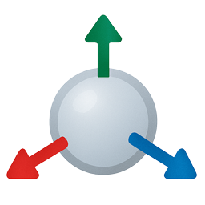

<p align="center">
  
</p>

# 3D Viewer

View 3D models in your browser. Your files never leave your device.

## Features

- Drag and drop (or click to pick) a model file
- Supported formats: glTF/GLB, OBJ, FBX, Collada (DAE), STL, 3DS
- Per-material texture assignment (PNG, JPG, TGA)
- Model information: file size, vertex and face counts, original dimensions, materials
- Orbit, zoom, wireframe and reset-view controls; models are auto-scaled and placed on a grid
- Resizable side panel; camera position persisted in `localStorage`

## Tech stack

React, TypeScript, Three.js, Tailwind CSS, built with Vite. Models and textures are read locally with object URLs; nothing is uploaded.

## Getting started

Requires Node.js 18+.

```bash
npm install
npm run dev
```

Then open http://localhost:5173.

## Scripts

| Command           | Description                          |
| ----------------- | ------------------------------------ |
| `npm run dev`     | Start the Vite dev server            |
| `npm run build`   | Type-check and build to `dist/`      |
| `npm run preview` | Serve the production build locally   |
| `npm run lint`    | Run ESLint on `src/`                 |

## Deployment

Every push to `master` is linted, built and deployed to GitHub Pages by `.github/workflows/deploy.yml`. The site is served at https://3dviewer.pxly.fr.

## Project structure

```
src/
  components/   UI and Three.js scene (ModelViewer, ThreeScene, SidePanel, ...)
  hooks/        useLocalStorage, useMediaQuery
  utils/        Model loading, model info extraction, lights, grid
  types/        Shared TypeScript types
```

## Limitations

- Models must be self-contained: external resources referenced by a model (`.bin` files for glTF, `.mtl` files for OBJ, external textures) are not resolved. Prefer GLB for glTF assets.
- Textures only show up on models that have UV coordinates (STL files, for instance, have none).
